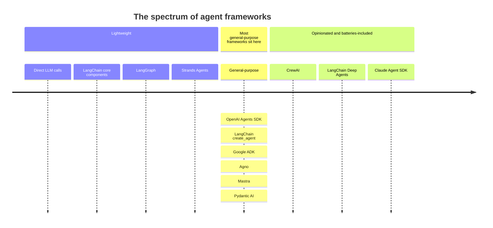

# The Spectrum of Agent Frameworks

Agent frameworks range from lightweight (you write most of the harness yourself) to opinionated and batteries-included (the harness comes ready-made). Where you pick on that line is a trade-off between control and speed. This note assumes you know what a harness is from [The agent loop](agent-loop.md).

## Why frameworks exist

An agent is an LLM plus a harness. The harness is code: the loop, the tool handler, limits, history, retries. You can write all of it by hand, as in [The agent loop](agent-loop.md), or use a framework that provides some or all of it.

Frameworks differ in how much of the harness they give you:

- At the lightweight end they give you building blocks, and you assemble the loop.
- At the other end they give you a complete harness with built-in tools, planning and conventions, and you configure it.

## The spectrum

The list below comes from the course. It places each framework from lightweight to opinionated, from left to right.

Read it left to right. The mark on the line is the position, and the names stacked under a mark share that position.

| Position | What you get | What you write |
| --- | --- | --- |
| Direct LLM calls | The model API and nothing else. | The whole harness: loop, tool handler, history, limits. |
| LangChain core components | Reusable pieces such as model wrappers and tool definitions. | The loop and how the pieces connect. |
| LangGraph | A way to describe an agent as a graph with shared state. | The nodes, the edges and the state. |
| General-purpose frameworks | A ready agent loop: give it a model, tools and a prompt. | The tools and the prompt. |
| LangChain Deep Agents, Claude Agent SDK | A full harness with built-in tools and planning. | Configuration, plus any custom tools. |

## Choosing a point on the line

| Toward lightweight | Toward opinionated |
| --- | --- |
| More control over every step. | Faster to a working agent. |
| More code to write and maintain. | Less code, but you follow the framework's conventions. |
| Easier to see exactly what is sent to the model. | More happens behind the scenes. |
| Easy to swap one piece. | Harder to change a part that the framework assumes. |

A reasonable habit is to learn the lightweight end first. Once you have written the loop yourself, you can tell what a framework is doing for you and what it hides.

## Gotchas

- **Position on the spectrum is a rough guide.** Frameworks add features over time, and where one sits is a judgment call.
- **A framework does not change what an agent is.** Underneath, it is still an LLM calling tools in a loop with a message history.
- **More built-in features means more to learn.** An opinionated framework saves code but adds concepts and defaults you need to understand.

## Vocabulary

| Term | Meaning |
| --- | --- |
| Agent framework | A library that provides part or all of an agent's harness. |
| Lightweight | A framework or approach that gives you building blocks and leaves the assembly to you. |
| Opinionated | A framework that makes many choices for you, such as built-in tools and a fixed way of working. |
| Batteries-included | Ships with the tools and features most agents need, so you add little yourself. |

## Related

- [The agent loop](agent-loop.md): the harness that every framework on this spectrum provides in some form.
- [Tool calling](tool-calling.md): the mechanism underneath all of them.
