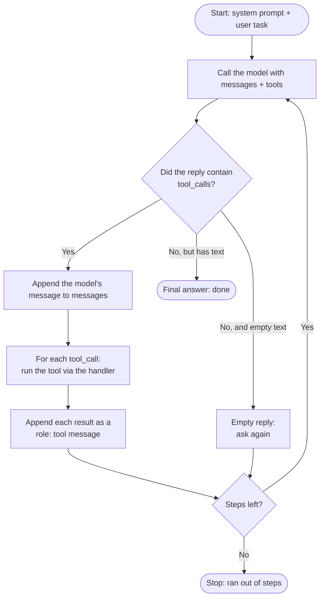
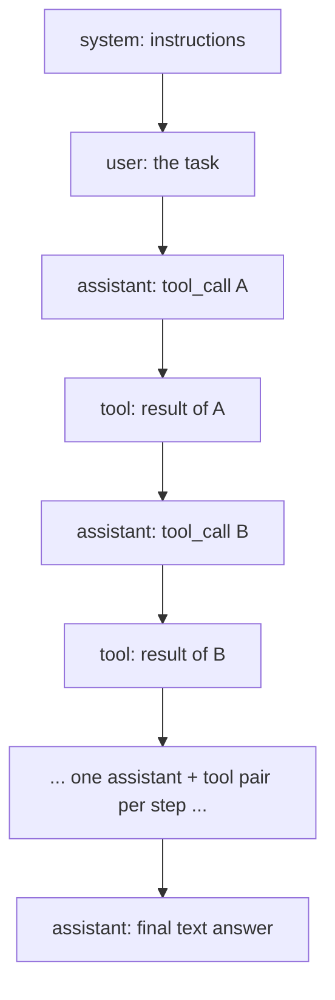
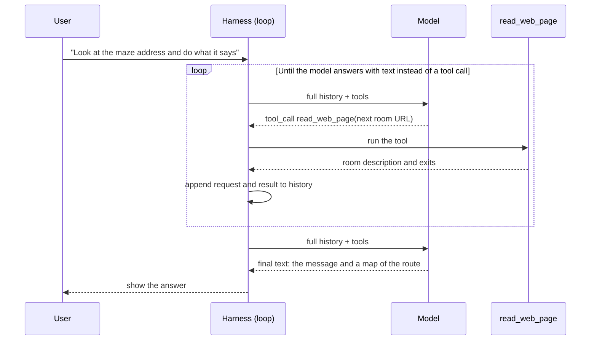

# The Agent Loop

An agent is tool calling wrapped in a loop: the model keeps asking for tools until it has enough to answer. This note assumes you know the basic round trip from [Tool calling](tool-calling.md).

## The loop

An agent is the same round trip wrapped in a loop. The model keeps asking for tools until it has enough to answer.

```python
def run_agent(task, max_steps=25):
    messages = [
        {"role": "system", "content": SYSTEM_PROMPT},
        {"role": "user", "content": task},
    ]
    for step in range(max_steps):
        response = client.chat.completions.create(model=MODEL, messages=messages, tools=tools)
        message = response.choices[0].message

        if message.tool_calls:
            messages.append(message)
            for tool_call in message.tool_calls:
                messages.append(handle_tool_call(tool_call))
        elif (message.content or "").strip():
            return message.content   # final answer
        # an empty reply: loop and ask again
    raise RuntimeError("The agent ran out of steps")
```



Stop conditions:

1. The model replies with text and no tool call. This is success.
2. The step limit is reached. This is a safety net so the agent cannot loop forever or burn through cost and rate limits.

## How the message history grows



The history is the agent's **only memory**. The model itself is stateless: each call is a fresh request that re-reads the whole history. A useful side effect is that any model can pick up a conversation mid-way, because everything it needs is in `messages`.

## Worked example: an agent that walks a maze

This example comes from Ed Donner's course "AI FDE: The Forward Deployed Engineer & Agentic AI Architect", where it is the first exercise. A small maze is hosted as a website. Each location is a web page that describes a room and lists its exits (links to other pages). Some passages are dead ends, and the way out holds a secret message. The agent has **one tool**, `read_web_page`, and has to explore by calling it once per room.

The tool returns the text of a page without the HTML, and refuses any address outside the maze:

```python
import requests
from bs4 import BeautifulSoup

MAZE_URL = "https://maze.edwarddonner.com"

def read_web_page(url):
    """Read a web page in the maze and return the text on the page, without the HTML"""
    if not url.startswith(MAZE_URL):
        return f"Sorry, this tool can only read pages in the maze. Please ask for a URL that starts with {MAZE_URL}"
    response = requests.get(url, timeout=20)
    page = BeautifulSoup(response.text, "html.parser")
    return page.body.get_text(separator="\n", strip=True)
```

Its schema is the same shape as the weather example, with a single `url` string argument. The agent loop is exactly the `run_agent` loop above, with a system prompt that asks for Markdown output and a step limit of 25.

What happens in a run:



What the example teaches:

- **One tool is enough for an agent.** Reading pages, choosing an exit, backing out of dead ends and remembering visited rooms all come from the model reasoning over the growing history.
- **The tool guards itself.** A request outside the maze gets a polite refusal that tells the model which URLs are allowed, so the model can correct itself.
- **The history is the memory.** In the course's run, different free models answered different steps and still finished the maze, because each one read the same history.
- **Cost is the number of steps.** One run took about 9 steps, each a full model call. Free tiers have daily request limits, so a lost agent can use up the quota.
- **Page content is untrusted input.** The maze's first page contains instructions addressed to the AI ("start with the maze now..."). That is how the exercise works, but in real systems text returned by a tool can carry hidden instructions, so treat it as data and not as commands.

## Gotchas

- **Smaller models are less reliable.** They may call a tool when they should answer, call it with bad arguments, or return an empty reply. A step limit and an empty-reply retry make the loop robust.
- **Every step costs a full model call.** The whole history is sent each time, so long runs get slower and more expensive as the history grows.

## Vocabulary

| Term | Meaning |
| --- | --- |
| Harness | Everything around the model: tools, handler, loop, system prompt, limits. |
| Agent | A model plus a harness that lets it call tools in a loop until the task is done. |

## Related

- [Tool calling](tool-calling.md): the single round trip this loop repeats.
