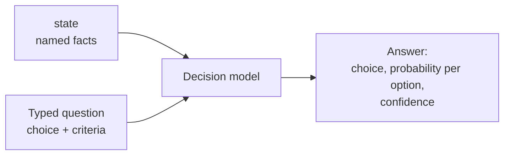
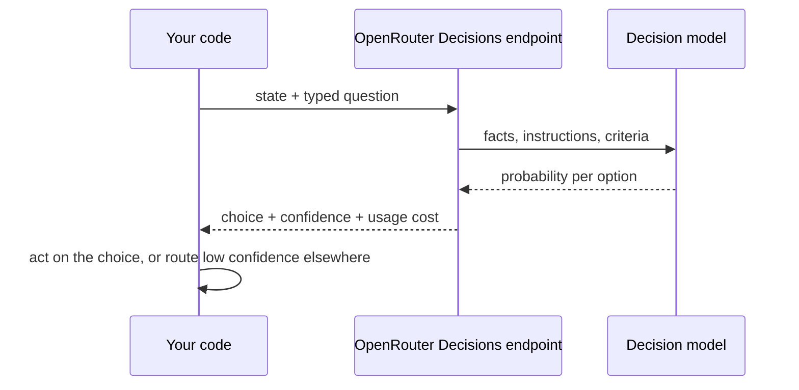
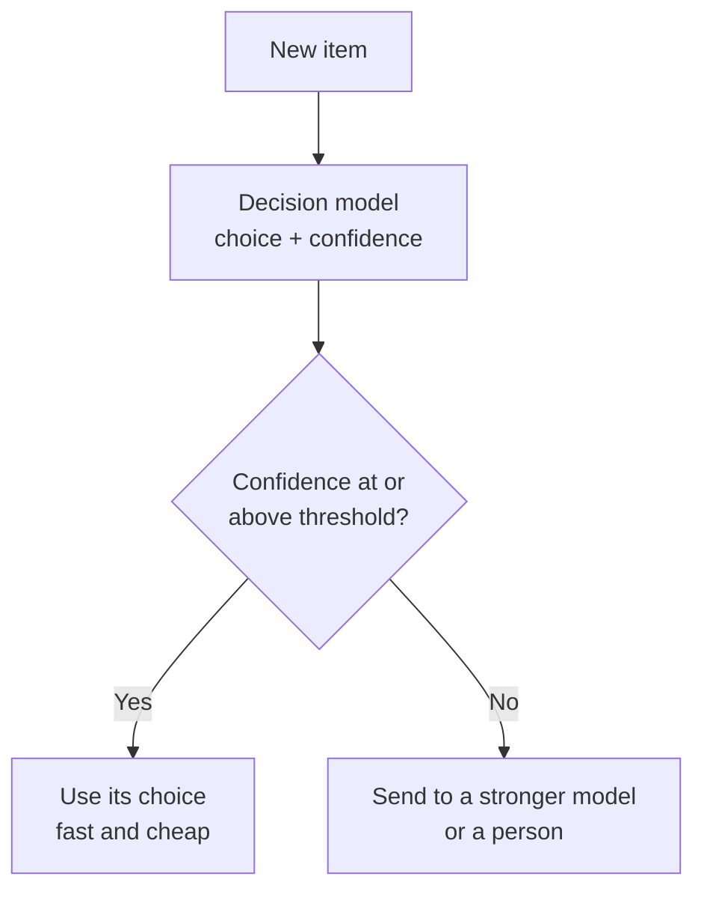

# Decision Models (Jev)

A decision model does not write text. You give it facts and a typed question, and it answers with a choice, a probability for each option and a confidence, in a fraction of a second. Jev, from TypeSafe AI, is an example. It is fast and cheap but narrow, so it works well as a first pass in front of a stronger model.

## What it does

A normal LLM takes a prompt and generates text. A decision model takes two structured inputs and returns a structured answer:

| Input or output | What it is |
| --- | --- |
| `state` | The facts, as named fields: for example a ticket and the customer's account. |
| Typed question | What to decide: the type (a choice), instructions, and a definition of each option. |
| Answer | The chosen option, a probability for each option, and a confidence. |

It cannot explain itself or do any work beyond choosing. It will not write a rationale or calculate an amount. That is the trade: you give up free text and get speed, low cost and an answer you can read in code.



## A generic example: triaging support tickets

Suppose each support ticket should go one of three ways: answer automatically, escalate to a person, or close.

```python
from openrouter import OpenRouter

client = OpenRouter(api_key=api_key, timeout_ms=60_000)

question = {
    "type": "choice",
    "instructions": "You triage support tickets. Decide `route` using the `ticket` and the customer's `account`.",
    "criteria": {
        "auto_reply": "The help articles answer the question and nothing about the account is unusual.",
        "escalate": "A person needs to look at it: a payment is involved, the customer is upset, or the account has a problem.",
        "close": "The ticket is spam, a duplicate, or needs no reply.",
    },
}


def triage(ticket, account):
    state = {"ticket": ticket, "account": account}
    response = client.alpha.decisions.create(
        model="typesafe/jev-1.13",
        state=state,
        questions={"route": question},
    )
    answer = response.answers["route"]
    return answer.choice, answer.confidence, response.usage.cost
```

Points to notice:

- The keys of `state` are names (`ticket`, `account`). The instructions refer to them by name in backticks, so the model knows which fact is which.
- The `criteria` dictionary defines each option in plain words. These definitions are the main thing you tune.
- `questions` is a dictionary, so one call can carry several named questions. Each answer comes back under the same name (`response.answers["route"]`).
- The answer carries `choice` and `confidence`, and `response.usage.cost` gives the cost of the call. The response also holds a probability for each option.

This example reads `choice` and `confidence` only.

## What happens on one call



## Using confidence: keep the sure answers, route the rest

Because the answer includes a confidence, you can split the work. Keep the answers the model is sure about, and send the rest to a stronger and slower model, or to a person.



```python
THRESHOLD = 0.9

choice, confidence, cost = triage(ticket, account)
if confidence >= THRESHOLD:
    route = choice
else:
    route = ask_stronger_model(ticket, account)
```

Pick the threshold by measurement, not by guess. Run the model on items where you already know the right answer, split the results by confidence, and check how accurate each group is.

## Example from the course

The course uses Jev on an insurance claims queue. For each claim the state holds the policy wording, the customer's policy record and the claim. The question is a choice between `approve`, `decline` and `refer`. The course scores Jev on the decision alone, because it cannot write a rationale or work out a payout. It then splits Jev's answers at a confidence of 0.9 to show the keep-or-escalate idea above.

## Gotchas

- **It only decides.** No rationale, no calculation, no tool calls. If you need those, use an LLM or an [agent](langchain-create-agent.md).
- **The state must contain everything.** The model cannot look anything up, so include every fact the decision needs.
- **The OpenAI client cannot reach it.** In the course it runs on OpenRouter's Decisions endpoint, so you use OpenRouter's own Python client with the same key.
- **The API is under `alpha`.** The call is `client.alpha.decisions.create(...)`, which suggests it may change. Check the current docs before relying on it.
- **Confidence is not a guarantee.** Measure how often the confident answers are actually right on your own data.
- **The criteria are the spec.** Vague definitions give vague decisions.

## Vocabulary

| Term | Meaning |
| --- | --- |
| Decision model | A model that picks from fixed options instead of generating text. |
| State | The named facts you pass in with the question. |
| Typed question | A question with a declared type, here a choice, plus instructions and criteria. |
| Criteria | The plain-words definition of each option. |
| Confidence | How sure the model is of its choice, used to decide whether to trust it or route the item elsewhere. |

## Related

- [Tool calling](tool-calling.md): the other way to get structured actions out of a model.
- [Building an agent with LangChain create_agent](langchain-create-agent.md): the heavier approach, where a model uses tools to look up facts and record the decision.
