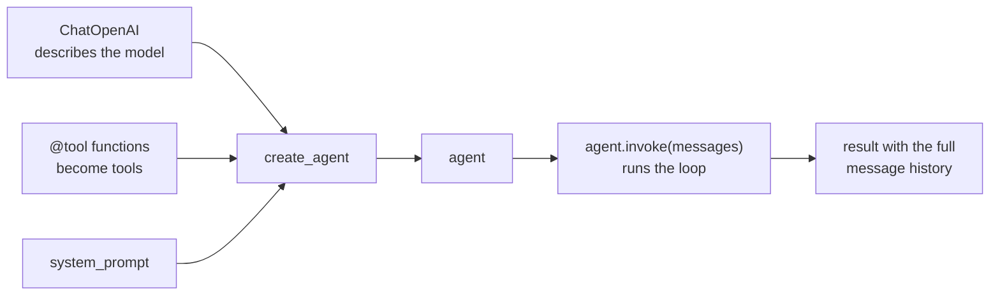
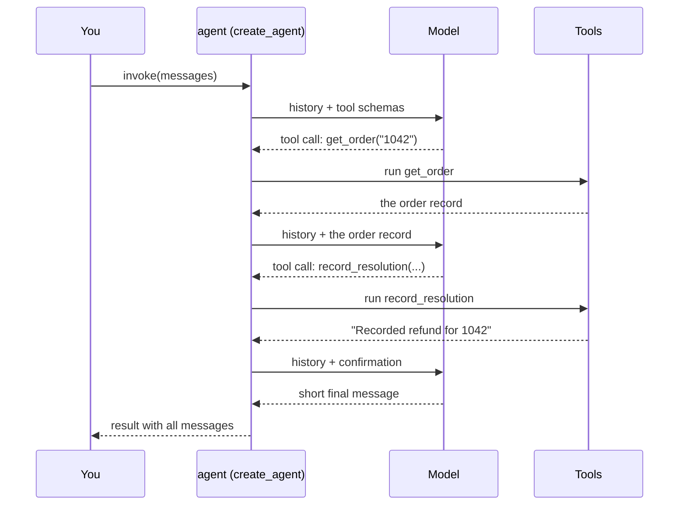

# Building an Agent with LangChain create_agent

LangChain's `create_agent` runs the [agent loop](agent-loop.md) for you. You describe the model, turn your functions into tools, and call `invoke()`. The loop, the tool handler and the message history are handled by the framework.

## What you write and what it writes

In [The agent loop](agent-loop.md) you write the loop by hand. With `create_agent` there are three steps:

1. Describe the model with a LangChain class such as `ChatOpenAI`.
2. Turn a function into a tool with `@tool`.
3. Call `create_agent` to build the agent, then `invoke()` to run it.



Behind the scenes `create_agent` builds a LangGraph graph. You do not need to know that to use it. LangGraph is covered separately in Week 2 of the course.

## A generic example: an order-support agent

The agent gets two tools. One looks up an order and one records how the issue was resolved.

```python
from typing import Literal

from langchain.agents import create_agent
from langchain_core.tools import tool
from langchain_openai import ChatOpenAI

llm = ChatOpenAI(model="MODEL_NAME", api_key=api_key)

resolutions = {}


@tool
def get_order(order_id: str) -> str:
    """Look up an order: the items, the price, the purchase date and the status."""
    order = orders.get(order_id)
    return json.dumps(order, indent=2) if order else f"There is no order {order_id}"


@tool
def record_resolution(order_id: str, action: Literal["refund", "replace", "reject"], note: str) -> str:
    """Record how an order issue was resolved.

    note is 1-2 sentences explaining the decision.
    """
    resolutions[order_id] = {"action": action, "note": note}
    return f"Recorded {action} for {order_id}"


agent = create_agent(
    model=llm,
    tools=[get_order, record_resolution],
    system_prompt="You handle order problems. Look up the order, then record your resolution.",
)

result = agent.invoke({"messages": [{"role": "user", "content": "Order 1042 arrived broken."}]})

for message in result["messages"]:
    message.pretty_print()
```

What each part does:

- `@tool` reads the function name, the type hints and the docstring, and turns them into the tool schema the model sees. The docstring is a prompt, so write it for the model.
- `Literal["refund", "replace", "reject"]` limits `action` to three values, so the model cannot invent a fourth.
- `system_prompt` is the instruction that stays at the top of the history.
- `invoke()` takes a dictionary with a `messages` list and returns a dictionary with the full `messages` list, including every tool call and result.

## What happens on one run



That is three model calls for one order: one to ask for the order, one to record the resolution and one to finish. Cost and time scale with the number of calls.

## What create_agent replaces

| In the hand-written loop | With create_agent |
| --- | --- |
| The `for` loop and the step limit | Handled inside `invoke()`. |
| Checking for `tool_calls` | Handled for you. |
| The `handle_tool_call` function and the schema dictionary | The `@tool` decorator and the function itself. |
| Appending messages to the history | Handled for you; the full history is in `result["messages"]`. |

## Example from the course

The course uses the same pattern on an insurance claims queue. The agent has two tools: `get_policy` looks up the customer's policy record, and `record_decision` saves an approve, decline or refer decision with a payout and a rationale. The system prompt carries the instructions and the policy wording. The user message holds only the claim, so the agent has to fetch the policy itself.

The course scores the agent by what ended up in the `recorded` dictionary, not by the model's final text. A claim with no recorded decision counts as wrong. It compares the agent with the same model used in a single call, which is a fair test because once the agent has fetched the policy it has the same information.

## Gotchas

- **The result is a side effect.** The useful output is whatever your tool stored, so check it, not the final message. If the model never calls `record_resolution`, nothing is recorded.
- **A global store needs clearing.** If tools write to a shared dictionary, clear it between runs or old results will hide a missed call.
- **Calls add up.** Each claim, or order, costs several model calls, each carrying the whole history.
- **Tool docstrings steer behaviour.** A vague description leads to wrong or missing tool calls.
- **Cost reporting depends on the provider.** The course reads each call's cost from the response metadata of the OpenRouter provider. Other providers may report it differently.
- **It is still the same loop.** `create_agent` hides the loop, but the limits and failure modes from [The agent loop](agent-loop.md) still apply.

## Vocabulary

| Term | Meaning |
| --- | --- |
| `create_agent` | LangChain function that builds an agent from a model, tools and a system prompt. |
| `ChatOpenAI` | LangChain class that describes a chat model; it can point at other providers through `base_url`. |
| `@tool` | Decorator that turns a Python function into a tool the model can call. |
| `invoke()` | Runs the agent on a set of messages and returns the full history. |

## Related

- [The agent loop](agent-loop.md): the loop that `create_agent` runs for you.
- [Tool calling](tool-calling.md): how a tool request and result pass between model and code.
- [The spectrum of agent frameworks](agent-frameworks.md): where `create_agent` sits among general-purpose frameworks.
- [Decision models (Jev)](jev-decision-models.md): a fast, narrow alternative when you only need a choice.
