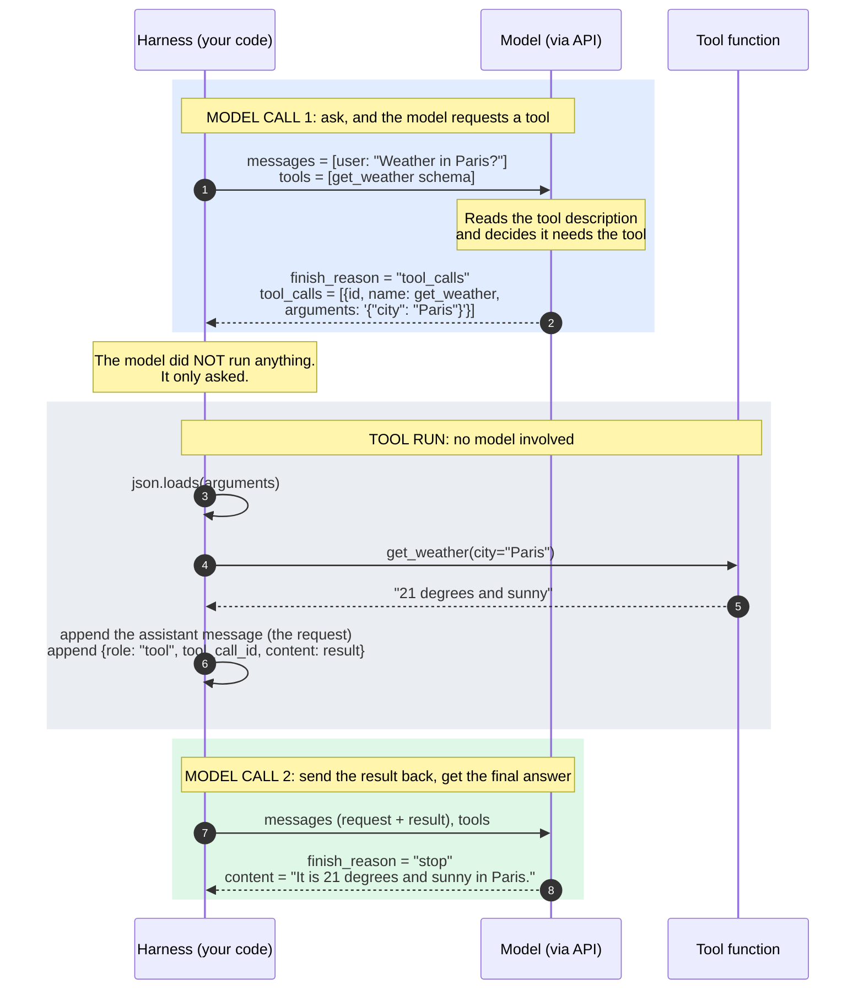
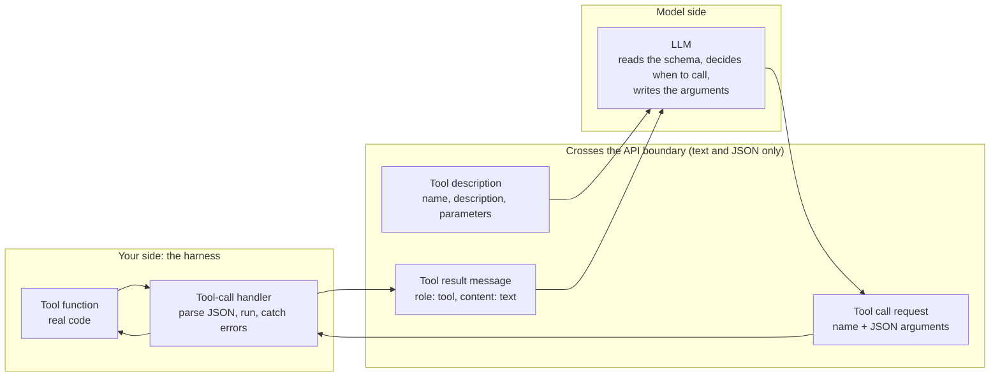

# Tool Calling

How a language model uses tools. The examples use the message format of OpenAI-style chat completion APIs, which many providers support. The idea is the same across providers.

## The one-line idea

**The model never runs code.** It only *asks* for a tool to be run, by replying with the tool's name and JSON arguments. Your program (the *harness*) runs the function and sends the result back as a new message. The model then continues from the longer conversation.

## The four pieces

| Piece | Example name | What it is |
| --- | --- | --- |
| Tool (function) | `get_weather(city)` | Ordinary code in your program. The model never sees it. |
| Tool description | a JSON schema passed as `tools=[...]` | The tool's name, what it does, and its arguments. This is all the model knows about the tool. |
| Tool-call handler | `handle_tool_call(tool_call)` | Parses the model's JSON arguments, runs the function, and wraps the result as a `role: "tool"` message. Errors are returned as text so the model can recover. |
| Message history | `messages = [...]` | The whole conversation. Every round trip appends to it, and the model re-reads all of it on every call. |

## Minimal code

The tool is a plain function:

```python
def get_weather(city):
    """Return the current weather for a city"""
    return f"It is 21 degrees and sunny in {city}"
```

The description tells the model what the tool is for and how to call it:

```python
get_weather_json = {
    "type": "function",
    "function": {
        "name": "get_weather",
        "description": "Get the current weather for a city",
        "parameters": {
            "type": "object",
            "properties": {
                "city": {"type": "string", "description": "The name of the city"},
            },
            "required": ["city"],
        },
    },
}

tools = [get_weather_json]
```

The handler runs whatever the model asked for and packages the result:

```python
import json

def handle_tool_call(tool_call):
    try:
        arguments = json.loads(tool_call.function.arguments)  # a JSON string, not a dict
        result = get_weather(**arguments)
    except Exception as error:
        result = f"The tool call failed: {error}"  # the model sees the error and can adapt
    return {"role": "tool", "tool_call_id": tool_call.id, "content": result}
```

One round trip looks like this:

```python
messages = [{"role": "user", "content": "What is the weather in Paris?"}]

response = client.chat.completions.create(model=MODEL, messages=messages, tools=tools)
message = response.choices[0].message          # finish_reason is "tool_calls"

messages.append(message)                       # first, the model's request
for tool_call in message.tool_calls:
    messages.append(handle_tool_call(tool_call))  # then, each result

response = client.chat.completions.create(model=MODEL, messages=messages, tools=tools)
print(response.choices[0].message.content)     # the final answer
```

## Diagram 1: a single tool call (one round trip)



Key points:

- `finish_reason == "tool_calls"` means the model wants a tool run. `"stop"` means this is its final answer.
- The `tool_call_id` links each result to the request that caused it. Without it the model cannot match them.
- Append the assistant's tool-call message **before** the tool result, or the API rejects the history.
- A tool-using answer costs at least **two model calls**: one to request the tool and one to use its result.
- If the model requests several tools at once, run all of them and append one result message for each.

## Diagram 2: what the model sees and what only you see



The model only ever sees the *description* of a tool. The quality of the tool's name, description and argument descriptions largely decides how well the model uses it.

## Gotchas

- **Failures go back as text.** Catch exceptions in the handler and return the error message as the tool result. The model can then retry or change approach instead of the loop crashing.
- **Tools should enforce their own limits.** If a tool should only reach certain resources, check that inside the tool and return a helpful message such as "only URLs starting with X are allowed". Do not rely on the model alone to behave.
- **Arguments arrive as a JSON string.** Always parse them with `json.loads`, and validate them before use.
- **The system prompt shapes behaviour, not tool availability.** Tools come from the `tools` parameter. The system prompt can guide when and how to use them, and how to format the output.

## Vocabulary

| Term | Meaning |
| --- | --- |
| Tool / function | Code the model can ask your program to run. |
| Tool schema | The JSON description of a tool's name, purpose and arguments. |
| Tool call | The model's request to run a tool, with arguments. |
| Tool result | The output you send back, as a message with `role: "tool"`. |

## Related

- [Agent loop](agent-loop.md): wrapping tool calling in a loop to get an agent.
